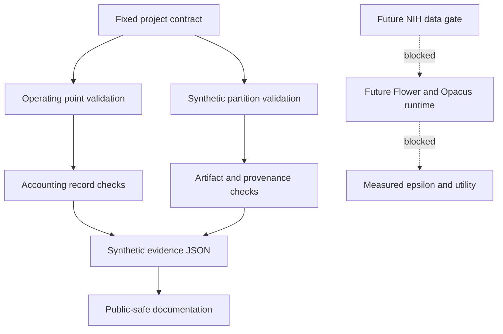

# PrivacyFL-DP

PrivacyFL-DP is a bounded research prototype for checking the local contracts around a future federated learning and differential privacy study. The current project is complete only for the local synthetic scope. It does not contain real NIH ChestX-ray14 data, model weights, training output, measured epsilon, measured AUC, or clinical evidence.

## Current Status

- Synthetic/local scope: complete with limitations.
- Project status: complete with limitations.
- Research execution: not released.
- Real NIH/federated results: not verified.
- Latest local test evidence: `python -m pytest tests -q` reported `23 passed in 0.15s`.
- Notebook status: `12` cells, `9` code cells, `0` executed code cells.
- Synthetic evidence status: `measured_epsilon` and `measured_auc` are `null`.

## Purpose

The project defines and tests a standard-library contract layer for a planned privacy-utility experiment. It validates constants, operating labels, synthetic partition isolation, accounting-record fail-closed behavior, artifact path safety, synthetic metric boundaries, and public-claim safeguards before any real dataset or federated runtime is approved.

## Architecture



## What Is Implemented

- `src/privacyfl_dp/config.py`: fixed labels, epsilon sentinels, delta, clipping norm, and total epochs.
- `src/privacyfl_dp/partition.py`: deterministic synthetic five-client partitions with overlap and evaluation-leakage checks.
- `src/privacyfl_dp/accounting.py`: planned, synthetic, measured, reviewed, and released accounting-record validation.
- `src/privacyfl_dp/artifacts.py`: artifact manifest, provenance, SHA-256 shape, and unsafe path checks.
- `src/privacyfl_dp/metrics.py`: synthetic metric schema and unsupported-claim rejection.
- `src/privacyfl_dp/synthetic_verify.py`: sanitized synthetic evidence generation.

## Reproducibility

From the project root, with Python and pytest already available:

```powershell
python -m pytest tests -q
$env:PYTHONPATH='src'
python -m privacyfl_dp.synthetic_verify --output planning/synthetic_contract_evidence.json --seed 17
```

Expected local evidence:

- Test suite: `23 passed in 0.15s`.
- Synthetic evidence JSON parses.
- `measured_epsilon` is `null`.
- `measured_auc` is `null`.
- The notebook remains unexecuted.

Do not install packages for this local closeout. If pytest or Python is unavailable, record the check as blocked rather than installing dependencies.

## Security Boundaries

This repository must not contain:

- NIH ChestX-ray14 files, patient data, PHI, or private identifiers.
- Model weights, checkpoints, datasets, generated figures, or real result artifacts.
- Credentials, `.env` files, private paths, API tokens, or external-service configuration.
- Claims of measured privacy, measured utility, clinical readiness, deployment, or publication.

The current tests are synthetic contract checks only. They do not validate Flower, Opacus, PyTorch, GPU execution, data licensing, model compatibility, or formal privacy guarantees.

## Federated-Learning Limitations

No federated learning runtime has been executed. There are no real clients, no Flower orchestration, no Opacus accountant state, no model training, no evaluation split, no measured epsilon, and no measured AUC. The local code only checks that future records fail closed when required evidence is missing or unsafe.

## NIH, Privacy, and Data-Access Blockers

The next major phase requires human approval and an approved remote/runtime environment. Remaining blockers include:

- NIH ChestX-ray14 source and license approval.
- Privacy and data-use review.
- Dependency and runtime compatibility review.
- Opacus compatibility validation.
- Real federated training approval.
- Measured epsilon and measured utility evidence.
- Leakage review and human privacy review.
- Release approval.

## Roadmap

1. Keep local synthetic contract checks green.
2. Obtain data/privacy/runtime approval before any real-data work.
3. Validate dataset source, terms, profile, split policy, and retention plan.
4. Validate model and runtime compatibility before privacy setup.
5. Run measured experiments only after gates pass.
6. Publish only reviewed artifacts with complete provenance.
