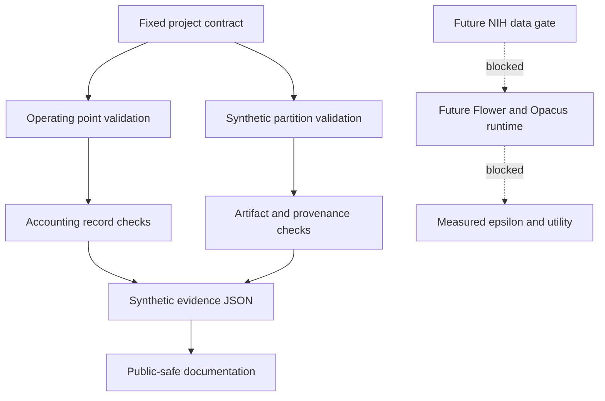

<div align="center">


[](tests/)
[](LICENSE)
[](docs/STATUS.md)
[](https://github.com/ajinkya-awari/privacyfl-dp)

</div>

PrivacyFL-DP is a federated learning and differential privacy research prototype on the NIH
ChestX-ray14 dataset. The local synthetic contract layer is complete. Real execution against the
real dataset is now in progress: one of six planned privacy operating points has a measured
result; the remaining five are not yet run. This repository contains no raw patient data, model
weights, or checkpoints — only code, tests, and disclosure-safe aggregate evidence.

> **Research artifact.** This is a bounded research prototype, not a clinical, production, or
> deployment-ready system. No clinical validation, diagnostic accuracy, or regulatory claim is
> made or implied anywhere in this repository.

Governance and process documentation (release gates, test checklists, evidence ledger) lives in
[`docs/`](docs/) to keep this README focused on the project itself.

## Current Status (updated 2026-10-24)

- Synthetic/local scope: complete with limitations.
- **Real execution: in progress.** 1 of 6 planned operating points (`epsilon = 0.1`) has a
  measured result (see "Real Execution Evidence" below). The remaining operating points
  (`0.5, 1.0, 5.0, 10.0, inf`) are not yet executed.
- This is ongoing work; the author expects the remaining operating points to take several more
  weeks of federated-learning GPU runs to complete.
- Latest local test evidence: `python -m pytest tests -q` reported `23 passed`.
- Synthetic evidence status: `measured_epsilon` and `measured_auc` are `null` (synthetic layer only;
  see the real evidence file for the actual measured result).

## Real Execution Evidence

Real training was run on the actual NIH ChestX-ray14 dataset (112,120 images, 5 federated clients,
official train/test split) with Opacus differential privacy. One operating point is measured so far:

| epsilon (target) | epsilon (actual, measured) | macro-AUC (measured) |
|---|---|---|
| 0.1 | 0.0962 | 0.497 |

Full machine-readable record: [`evidence/real_run_label_0.1.json`](evidence/real_run_label_0.1.json).

**Honest interpretation — read before citing this number anywhere:**
- A macro-AUC of ~0.497 on a 14-class task is statistically indistinguishable from chance. This is
  an honest result from a small custom CNN trained for only 30 total epochs under strong
  differential-privacy noise — it is **not** evidence that the model "works," and is not described
  as such anywhere in this repository.
- The actual epsilon was composed across multiple training sessions using a checkpoint/resume
  mechanism (training was interrupted and resumed using Kaggle's free GPU quota, which resets
  weekly). This composition method has not yet been independently cross-checked against an
  equivalent single, uninterrupted training run. Treat this result as **measured, not yet fully
  reviewed**.
- This is not a clinical validation and not a formal, audited privacy guarantee beyond the stated
  mechanism (per-sample gradient clipping with Gaussian noise, RDP accounting, honest-but-curious
  threat model only).

## Purpose

The project defines and tests a standard-library contract layer for a planned privacy-utility experiment. It validates constants, operating labels, synthetic partition isolation, accounting-record fail-closed behavior, artifact path safety, synthetic metric boundaries, and public-claim safeguards before any real dataset or federated runtime is approved.

## Architecture



## What Is Implemented

- `src/privacyfl_dp/config.py`: fixed labels, epsilon sentinels, delta, clipping norm, and total epochs.
- `src/privacyfl_dp/partition.py`: deterministic synthetic five-client partitions with overlap and evaluation-leakage checks.
- `src/privacyfl_dp/accounting.py`: planned, synthetic, measured, reviewed, and released accounting-record validation.
- `src/privacyfl_dp/artifacts.py`: artifact manifest, provenance, SHA-256 shape, and unsafe path checks.
- `src/privacyfl_dp/metrics.py`: synthetic metric schema and unsupported-claim rejection.
- `src/privacyfl_dp/synthetic_verify.py`: sanitized synthetic evidence generation.

## Reproducibility

From the project root, with Python and pytest already available:

```powershell
python -m pytest tests -q
$env:PYTHONPATH='src'
python -m privacyfl_dp.synthetic_verify --output planning/synthetic_contract_evidence.json --seed 17
```

Expected local evidence:

- Test suite: `23 passed in 0.15s`.
- Synthetic evidence JSON parses.
- `measured_epsilon` is `null`.
- `measured_auc` is `null`.
- The notebook remains unexecuted.

Do not install packages for this local closeout. If pytest or Python is unavailable, record the check as blocked rather than installing dependencies.

## Security Boundaries

This repository must not contain:

- NIH ChestX-ray14 files, patient data, PHI, or private identifiers.
- Model weights, checkpoints, datasets, generated figures, or real result artifacts.
- Credentials, `.env` files, private paths, API tokens, or external-service configuration.
- Claims of measured privacy, measured utility, clinical readiness, deployment, or publication.

The current tests are synthetic contract checks only. They do not validate Flower, Opacus, PyTorch, GPU execution, data licensing, model compatibility, or formal privacy guarantees.

## Federated-Learning Limitations

No federated learning runtime has been executed. There are no real clients, no Flower orchestration, no Opacus accountant state, no model training, no evaluation split, no measured epsilon, and no measured AUC. The local code only checks that future records fail closed when required evidence is missing or unsafe.

## NIH, Privacy, and Data-Access Blockers

The next major phase requires human approval and an approved remote/runtime environment. Remaining blockers include:

- NIH ChestX-ray14 source and license approval.
- Privacy and data-use review.
- Dependency and runtime compatibility review.
- Opacus compatibility validation.
- Real federated training approval.
- Measured epsilon and measured utility evidence.
- Leakage review and human privacy review.
- Release approval.

## Roadmap

1. Keep local synthetic contract checks green.
2. Obtain data/privacy/runtime approval before any real-data work.
3. Validate dataset source, terms, profile, split policy, and retention plan.
4. Validate model and runtime compatibility before privacy setup.
5. Run measured experiments only after gates pass.
6. Publish only reviewed artifacts with complete provenance.
